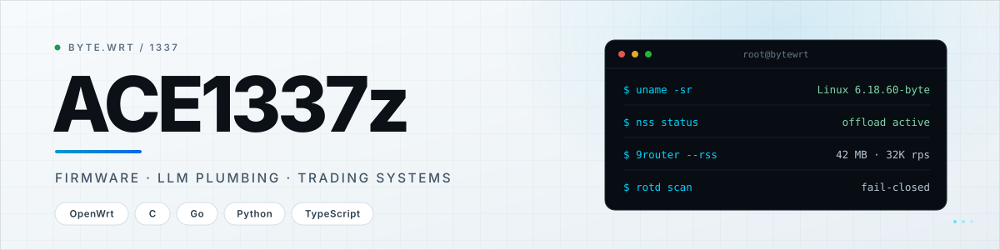

<picture>
  <source media="(prefers-color-scheme: dark)" srcset="https://raw.githubusercontent.com/Ace1337z/Ace1337z/main/assets/banner-dark.svg">
  
</picture>

 

[repositories](https://github.com/Ace1337z?tab=repositories) &nbsp;·&nbsp; [telegram](https://t.me/bytewrt) &nbsp;·&nbsp; [commits](https://github.com/Ace1337z?tab=overview)

## Selected work

<table>
<tr>
<td width="50%" valign="top">

### [AW1000_NSS_BYTE](https://github.com/Ace1337z/AW1000_NSS_BYTE)

<code>OpenWrt</code> <code>C</code> <code>NSS</code>

BYTE 1.0.7 for the Arcadyan AW1000. NSS Wi-Fi offload, kernel 6.18.60, a working
RJ11 phone, PassWall2 and 9Router inside one sysupgrade image.

</td>
<td width="50%" valign="top">

### [luci-app-9router](https://github.com/Ace1337z/luci-app-9router)

<code>OpenWrt</code> <code>Shell</code> <code>Go</code>

LuCI control plane for 9router-go. SHA256-verified static gateway, supervised by
procd, with a rollback copy kept on disk.

</td>
</tr>
<tr>
<td width="50%" valign="top">

### [luci-app-byte](https://github.com/Ace1337z/luci-app-byte)

<code>OpenWrt</code> <code>LuCI</code> <code>Shell</code>

Install, wire, inspect and undo the AdGuard Home + PassWall2 DNS chain from one
page. Feed-managed packages, no vendor tarball.

</td>
<td width="50%" valign="top">

### [openwrt-agh-passwall2](https://github.com/Ace1337z/openwrt-agh-passwall2)

<code>OpenWrt</code> <code>Shell</code>

Conflict-free AGH + PassWall2 installer. Validates the config before cutover,
restores everything on failure, reruns without duplicating state.

</td>
</tr>
<tr>
<td width="50%" valign="top">

### [RT-AX52_BYTE](https://github.com/Ace1337z/RT-AX52_BYTE)

<code>OpenWrt</code> <code>MT7981B</code> <code>Actions</code>

ImmortalWrt 25.12 for the ASUS RT-AX52. PassWall2 and Xray baked in, tuned for
256 MB of RAM, built by CI on every push.

</td>
<td width="50%" valign="top">

### [Runner-of-the-Day](https://github.com/Ace1337z/Runner-of-the-Day)

<code>Python</code> <code>Finviz</code> <code>Telegram</code>

Micro-cap runner detector. Ranks before it alerts, fails closed on bad data,
writes a miss report for every runner it did not flag, and places no orders.

</td>
</tr>
</table>

## Also building

**[LOOPR](https://github.com/Ace1337z/LOOPR)** — Expo + Supabase match play with real ELO, no mock mode.  
**[AW1000_BYTE](https://github.com/Ace1337z/AW1000_BYTE)** — retired firmware; the repo branch lives on as a signed opkg feed.  
**[penny-early-warning](https://github.com/Ace1337z/penny-early-warning)** — archived first pass at pre-move micro-cap alerts.

## Toolchain

<code>OpenWrt</code> <code>C</code> <code>Go</code> <code>Python</code> <code>TypeScript</code> <code>Shell</code> <code>Supabase</code> <code>Expo</code> <code>GitHub Actions</code>

## Activity

<picture>
  <source media="(prefers-color-scheme: dark)" srcset="https://github-profile-summary-cards.vercel.app/api/cards/profile-details?username=Ace1337z&theme=github_dark">
  
</picture>

  

Rank 1337, by choice.

