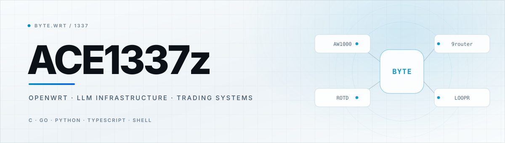
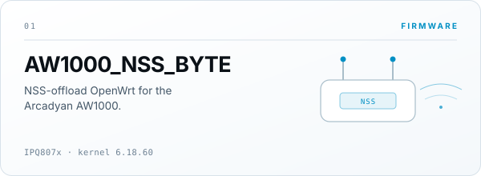
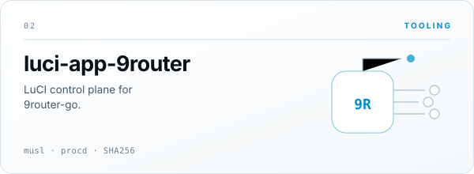
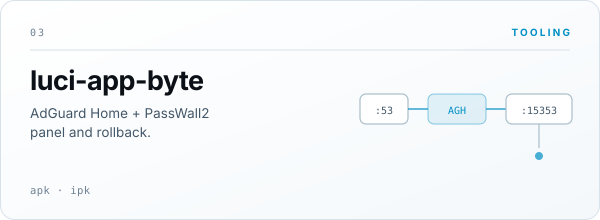
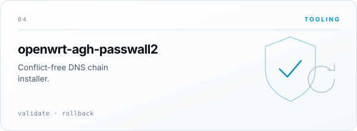
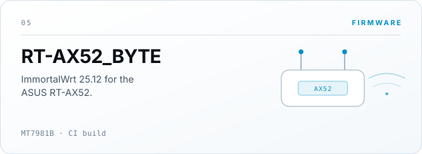
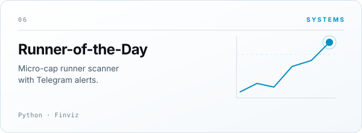

<picture>
  <source media="(prefers-color-scheme: dark)" srcset="https://raw.githubusercontent.com/Ace1337z/Ace1337z/main/assets/hero-dark.svg">
  
</picture>

<table>
<tr>
<td width="50%" valign="top">
<a href="https://github.com/Ace1337z/AW1000_NSS_BYTE"><picture>
  <source media="(prefers-color-scheme: dark)" srcset="https://raw.githubusercontent.com/Ace1337z/Ace1337z/main/assets/cards/01-aw1000-nss-dark.svg">
  
</picture></a>
</td>
<td width="50%" valign="top">
<a href="https://github.com/Ace1337z/luci-app-9router"><picture>
  <source media="(prefers-color-scheme: dark)" srcset="https://raw.githubusercontent.com/Ace1337z/Ace1337z/main/assets/cards/02-luci-9router-dark.svg">
  
</picture></a>
</td>
</tr>
<tr>
<td width="50%" valign="top">
<a href="https://github.com/Ace1337z/luci-app-byte"><picture>
  <source media="(prefers-color-scheme: dark)" srcset="https://raw.githubusercontent.com/Ace1337z/Ace1337z/main/assets/cards/03-luci-byte-dark.svg">
  
</picture></a>
</td>
<td width="50%" valign="top">
<a href="https://github.com/Ace1337z/openwrt-agh-passwall2"><picture>
  <source media="(prefers-color-scheme: dark)" srcset="https://raw.githubusercontent.com/Ace1337z/Ace1337z/main/assets/cards/04-agh-passwall2-dark.svg">
  
</picture></a>
</td>
</tr>
<tr>
<td width="50%" valign="top">
<a href="https://github.com/Ace1337z/RT-AX52_BYTE"><picture>
  <source media="(prefers-color-scheme: dark)" srcset="https://raw.githubusercontent.com/Ace1337z/Ace1337z/main/assets/cards/05-rt-ax52-dark.svg">
  
</picture></a>
</td>
<td width="50%" valign="top">
<a href="https://github.com/Ace1337z/Runner-of-the-Day"><picture>
  <source media="(prefers-color-scheme: dark)" srcset="https://raw.githubusercontent.com/Ace1337z/Ace1337z/main/assets/cards/06-rotd-dark.svg">
  
</picture></a>
</td>
</tr>
</table>

More — <a href="https://github.com/Ace1337z/LOOPR">LOOPR</a> ·
<a href="https://github.com/Ace1337z/AW1000_BYTE">AW1000_BYTE</a> ·
<a href="https://github.com/Ace1337z/penny-early-warning">penny-early-warning</a> ·
<a href="https://t.me/bytewrt">Telegram</a>

